# Informe técnico

Detalle de cada hito, con todas las cifras. Cada número sale de un JSON en
`docs/resultados/`; los gráficos están en la misma carpeta, en PNG y en HTML (con tooltip).

| Hito | Qué hay | Resultado principal |
|---|---|---|
| [1. Datos y cliente](#hito-1-ingesta-exploración-sospechas-y-reconstrucción-del-cliente) | Ingesta, partición, exploración, sospechas y cliente | El cliente es `card1 + addr1 + D1n` exacto. **La etiqueta se propaga por cliente:** con un fraude conocido 30 días antes, el 58 % de las transacciones siguientes del mismo cliente son fraude (16 veces la prevalencia) |
| [2. Grafo y vecindario](#hito-2-grafo-de-identidad-compartida-y-variables-de-vecindario) | Seis entidades, 139 variables solo con pasado, ocho variantes medidas una vez en prueba | Con el esquema realista (etiquetas hasta el día 90), una logística de vecindario llega a **AP 0,360** en prueba: **0,182 en clientes nuevos y 0,784 en ya vistos**. Sin retraso de etiquetas daría 0,681 |

---

## Hito 1: ingesta, exploración, sospechas y reconstrucción del cliente

### Datos y partición

- `train_transaction.csv` y `train_identity.csv` de IEEE-CIS: **590.540 transacciones**,
  144.233 con identidad (24,4 %). Huellas SHA-256 en
  [carga.json](docs/resultados/hito1/carga.json). Los archivos de prueba de la competencia no
  traen etiqueta y no se leen: la ingesta los rechaza y una prueba verifica que el código no
  los nombre.
- Esquema explícito (`esquema.py`): texto, enteros (identificadores, tiempo, códigos de tarjeta
  y dirección) y el resto `DOUBLE`. Sale de revisar cada columna completa.
- `dia = TransactionDT // 86400` va de 1 a 182; `TransactionID` crece con el tiempo (ningún
  par fuera de orden). La fecha de calendario es desconocida.
- **Partición fijada antes de mirar etiquetas** (tag `particion-fijada`):

| Periodo | Días | Transacciones |
|---|---|---|
| Entrenamiento | 1 a 90 | 315.927 |
| Validación | 91 a 120 | 98.615 |
| Prueba | 121 a 182 (8 semanas y una de 6 días) | 175.998 |

- ~~Simplificación declarada: el modelo se entrenará con todas las etiquetas de
  desarrollo.~~ **Reemplazada en el hito 2** por el esquema realista: con 30 días de retraso,
  al desplegar el día 121 solo se conocen las etiquetas hasta el día 90, y con ellas se
  entrena, se valida y se elige el umbral. Todas las etiquetas quedan solo como comparación.

### Exploración (desarrollo, días 1 a 120)

[exploracion.json](docs/resultados/hito1/exploracion.json)

- **414.542 transacciones y 14.600 fraudes: prevalencia 3,52 %.** El primer bloque de 30
  días tiene 2,53 % y los tres siguientes, entre 3,95 % y 4,04 %. Las semanas 3 y 4 tienen el
  mayor volumen (unas 35 mil transacciones) y la menor prevalencia (2,1-2,4 %); es
  compatible con una temporada de compras, pero la fecha real no se conoce.

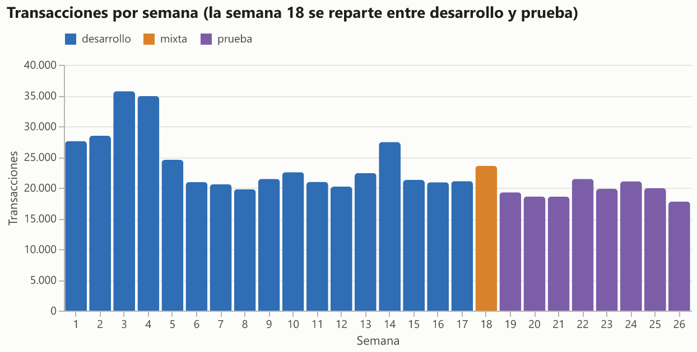
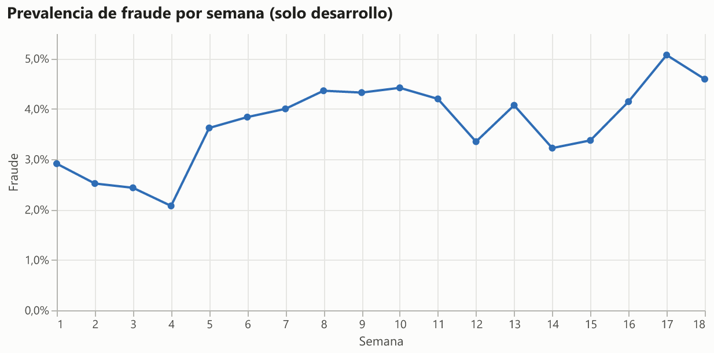

- **Producto:** C tiene 11,2 % de fraude, S 6,0 %, H 4,5 %, R 3,5 % y W 2,1 %; W es el 72 %
  del volumen.
- **Decimales del monto:** casi todo C tiene tres o más decimales (45.328 de 50.136), lo que
  sugiere conversión de moneda. En W, los montos con centavos tienen 0,78 % de fraude y los
  enteros, 3,34 %. Es información disponible al pagar: no se trata como sospechosa, pero sí
  como posible artefacto de cómo Vesta registró los montos.

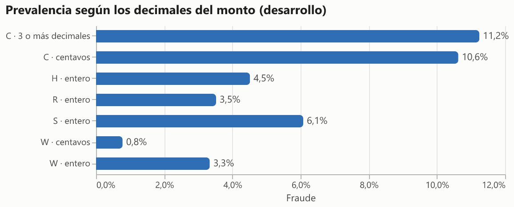

- **Identidad:** con identidad hay 7,34 % de fraude; sin ella, 2,14 %. En móvil, 9,87 %; en
  escritorio, 5,96 %. Crédito tiene 6,61 % y débito, 2,41 %.
- **Monto:** la mediana es 68,95 en legítimas y 76,02 en fraudes; el percentil 90, 270 y 335.
- **Faltantes:** las V faltan en 15 bloques que faltan juntos. Entre desarrollo y prueba (sin
  etiquetas), las columnas **M pasan de 55,7 % a 36,3 % de faltantes** y la identidad, de
  83,1 % a 87,8 %: deriva que el monitoreo del hito 4 tiene que ver.

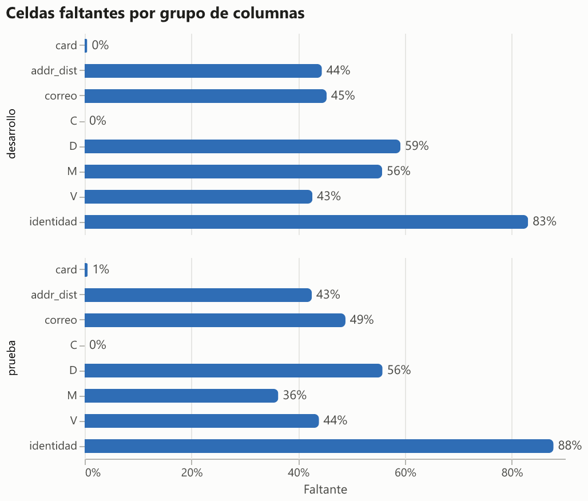

### Reconstrucción del cliente

[clientes.json](docs/resultados/hito1/clientes.json) · el paso no lee etiquetas.

`D1` son los días desde el alta de la tarjeta, así que `D1n = dia - D1` es el día de alta y
debería ser constante para una tarjeta. Sin verdad conocida, la calidad se mide con atributos
que **no** se usan para unir: correo, `D10n`, `D15n` y dispositivo deberían coincidir entre
transacciones consecutivas del mismo cliente. `card2` a `card6` y `addr2` no sirven para esto:
coinciden en más del 99 % aun agrupando solo por `card1` (dependen del código de tarjeta).

| Nivel | Clientes | Tx en clientes de una sola tx | Correo | D10n | D15n | Dispositivo |
|---|---|---|---|---|---|---|
| `card1` | 13.553 | 0,6 % | 0,429 | 0,289 | 0,249 | 0,465 |
| `card1 + addr1` | 39.974 | 2,7 % | 0,478 | 0,312 | 0,285 | 0,496 |
| **`uid` = `card1 + addr1 + D1n`** | **217.850** | 21,2 % | **0,781** | **0,666** | **0,695** | **0,640** |
| `uid` con ±1 día (descartado) | 187.997 | 16,8 % | 0,727 | 0,609 | 0,632 | 0,597 |
| `uid` con veto de correo (descartado) | 254.704 | 26,8 % | 0,999* | 0,678 | 0,714 | 0,715 |

\* El veto usa el correo, así que su concordancia de correo no vale como validación.

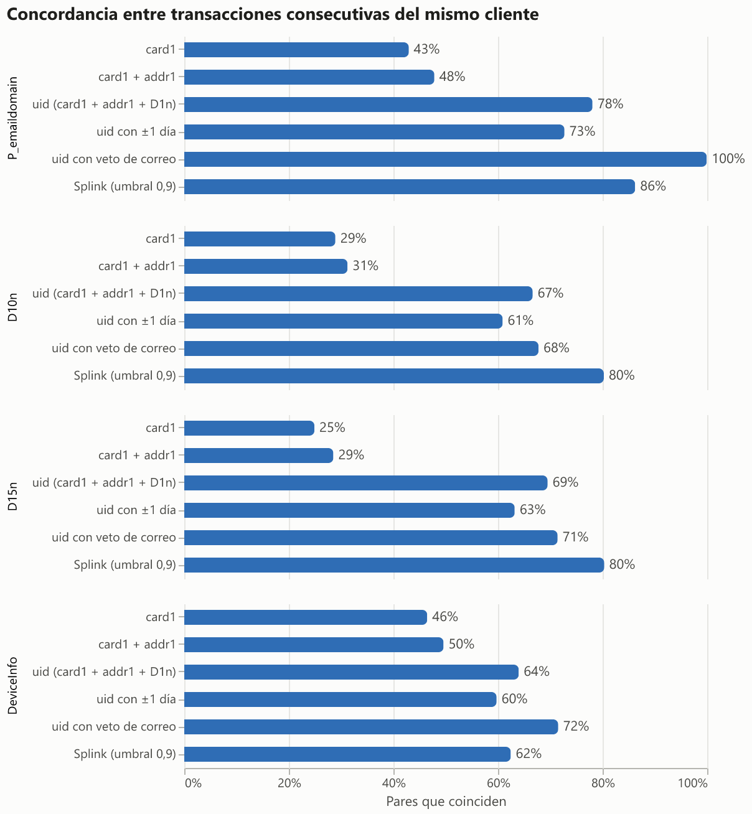

**Dos variantes medidas y descartadas.** Para leerlas, sirven dos referencias: los pares
consecutivos del mismo `uid` coinciden en `D10n` el 66,6 % de las veces, y los pares de `uid`
distintos dentro de la misma `card1 + addr1`, el 7,3 %.

1. **Tolerancia de un día en `D1n`.** La propuse en el plan pensando en la hora y la zona
   horaria. Los datos dicen otra cosa: los 50.715 pares que agrega coinciden en `D10n` el
   4,4 % de las veces y en `D15n` el 4,5 %, el nivel de clientes distintos. Tampoco cerca de
   la medianoche: entre las 0 y las 3 h, coinciden en `D10n` el 5,1 % (11.788 pares). Une
   tarjetas distintas dadas de alta en días consecutivos. `D1n` es exacto.
2. **Veto por correo distinto.** Separa 70.634 pares que coinciden en `D10n` el 58,0 % y en
   `D15n` el 55,5 %: por esas dos, entre el 79 % y el 85 % serían del mismo cliente. Es la
   lección de los vetos del proyecto 1. Pero en dispositivo coinciden solo el 26,6 %, como
   clientes distintos: la misma tarjeta usada desde otro dispositivo y otro correo. Por eso el
   `uid` es la **cuenta de tarjeta**, y un cambio de correo o de dispositivo es información
   para el modelo, no un corte. Mirando etiquetas de desarrollo, el cambio no eleva el fraude
   por sí solo: con correo distinto al de la transacción anterior del cliente, 4,23 %; con el
   mismo, 4,35 %. Con el mismo dispositivo el fraude es mayor (10,1 % frente a 6,8 %), algo
   compatible con la propagación (el defraudador repite dispositivo). Ver
   `cambio_de_atributo_desarrollo` en sospechas.json.

**`D1 = 0` es frecuente** (47 % de las transacciones; 89 % en R y 95 % en H). Solo el 34 % de
esas transacciones tiene después otra del mismo `uid` con `D1 > 0`, como cabría esperar del
alta de una tarjeta que sigue activa (37 % en W, 18 % en H, 13 % en R). En H y R parece que
`D1` no se actualiza, y el `uid` de esos productos se parte por día. Queda como
limitación: el grafo del hito 2 conecta esos fragmentos por correo, dispositivo y dirección.

**Splink como referencia fuera de línea.** Fellegi-Sunter entrenado con EM y sin etiquetas,
sobre transacciones, con bloqueo dentro de `card1 + addr1` y comparaciones de `D1n`, `D10n`,
`D15n`, correo y producto. Ve toda la ventana (también el futuro), así que no entra al modelo.
`DeviceInfo` queda fuera de Splink para validar las dos agrupaciones con algo que ninguna usa.

| Umbral de Splink | Grupos | Pares de `uid` que Splink une | Pares de Splink dentro de un `uid` | Dispositivo |
|---|---|---|---|---|
| 0,5 | 281.441 | 81,5 % | 70,7 % | 0,644 |
| 0,9 | 314.696 | 44,6 % | 89,4 % | 0,624 |
| 0,99 | 342.388 | 36,4 % | 100,0 % | 0,614 |
| `uid` (en línea) | 217.850 | | | 0,640 |

Splink parte sobre todo los `uid` grandes y une poco entre ellos. En el atributo que ninguno
usa, no mejora al `uid` en ningún umbral (0,614 a 0,644 contra 0,640). Una resolución
probabilística con acceso al futuro no justifica algo más complejo que la clave en línea.

**Clientes de prueba ya vistos.** El 40,3 % de las transacciones de prueba son de un `uid` que
apareció en desarrollo: 51,7 % en la primera semana de prueba y 31,7 % en la novena. Es la
base del reporte separado de clientes nuevos y ya vistos del hito 3.

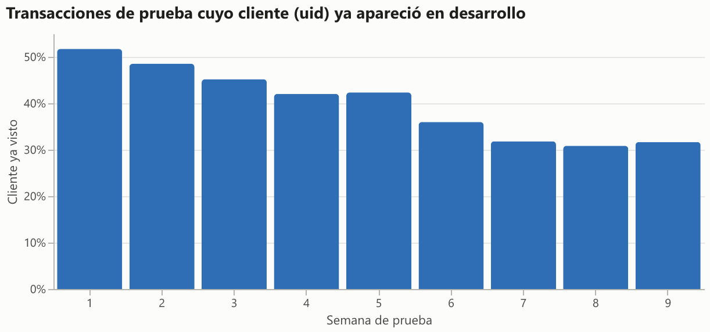

### Sospechas de filtración

[sospechas.json](docs/resultados/hito1/sospechas.json)

**1. Propagación de la etiqueta por cliente (confirmada).** Los organizadores contaron que,
tras un contracargo, marcaron como fraude transacciones posteriores ligadas a la misma cuenta,
correo o dirección. En desarrollo, con el `uid`:

| Situación de la transacción | Fraude |
|---|---|
| Todas | 3,52 % |
| Primera del cliente | 2,64 % |
| El cliente tiene historia, pero sin fraude previo | 0,65 % |
| El cliente ya tuvo un fraude antes | 44,1 % |

| Días desde el primer fraude del cliente | Transacciones | Fraude |
|---|---|---|
| 0 a 1 | 12.366 | 32,3 % |
| 1 a 7 | 2.459 | 73,1 % |
| 7 a 30 | 2.620 | 60,3 % |
| 30 a 60 | 1.350 | 57,7 % |
| 60 o más | 1.032 | 57,8 % |

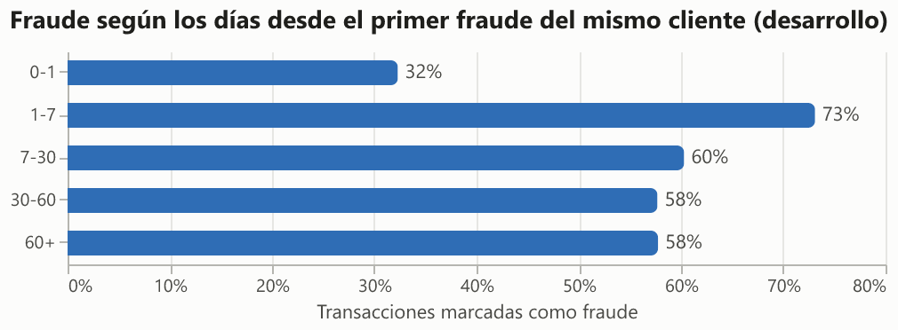

**Con el retraso del contracargo.** En producción, el fraude de una transacción se sabe días
después. La regla "el cliente ya tuvo un fraude conocido" con cada retraso:

| Retraso | Transacciones marcadas | Precisión | Fraudes cubiertos |
|---|---|---|---|
| 0 días (no realista) | 19.827 | 44,1 % | 59,9 % |
| 15 días | 3.713 | 57,9 % | 14,7 % |
| **30 días (base)** | 2.382 | **57,7 %** | **9,4 %** |
| 60 días | 1.032 | 57,8 % | 4,1 % |
| 90 días | 322 | 56,8 % | 1,3 % |

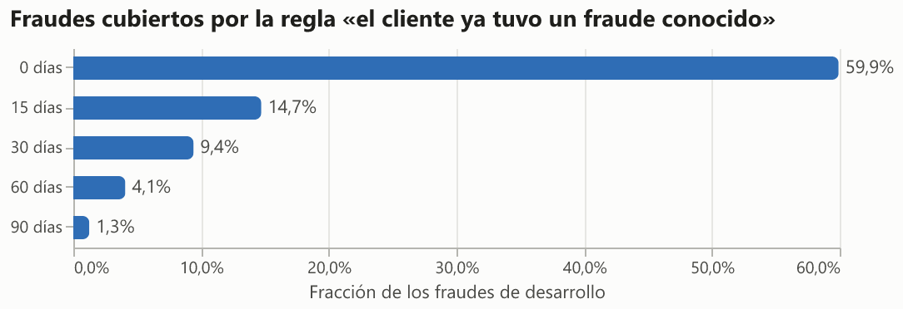

Consecuencias:

- Una variable de "fraudes previos del cliente" **sin retraso** cubriría el 60 % de los
  fraudes: es filtración. Con el retraso base de 30 días, la señal es legítima en producción
  pero pequeña (9,4 % de los fraudes) e inflada por la regla de etiquetado de la competencia
  (en la realidad, la tarjeta se bloquea).
- El modelo puede **memorizar clientes**: el 40 % de las transacciones de prueba son de
  clientes ya vistos. El hito 3 reporta clientes nuevos y ya vistos por separado y hace
  ablación de las variables de identidad e historia del cliente.

> **Corrección.** Durante el trabajo comuniqué en el chat una precisión del 90 % para esta
> regla. Venía de un cálculo exploratorio con un error: `cummin` de pandas deja NaN en las
> filas sin fraude, así que solo miraba si la transacción inmediatamente anterior era fraude.
> La cifra correcta es la de la tabla, calculada por `sospechas.propagacion` con una prueba
> que verifica que el primer fraude previo no incluye la transacción actual.

**2. ¿Las C, D o V agregan el futuro? Sin evidencia.** En la primera transacción de 93.713
tarjetas nuevas (`D1 = 0`, producto W, con 30 días de datos por delante), se correlacionó cada
columna con el número de transacciones del cliente en los 30 días siguientes. Una variable en
línea no tiene historia que mirar en ese momento; una que agrega la ventana completa sí
correlaciona (en el mini-IEEE, un total plantado da ρ > 0,5). Ninguna de las 159 columnas
evaluadas llega a |ρ| = 0,3: la mayor es D3 (0,127; probablemente los días desde la
transacción anterior), después D15 (0,078), y entre las C, C1 (0,065). El monto da −0,031.

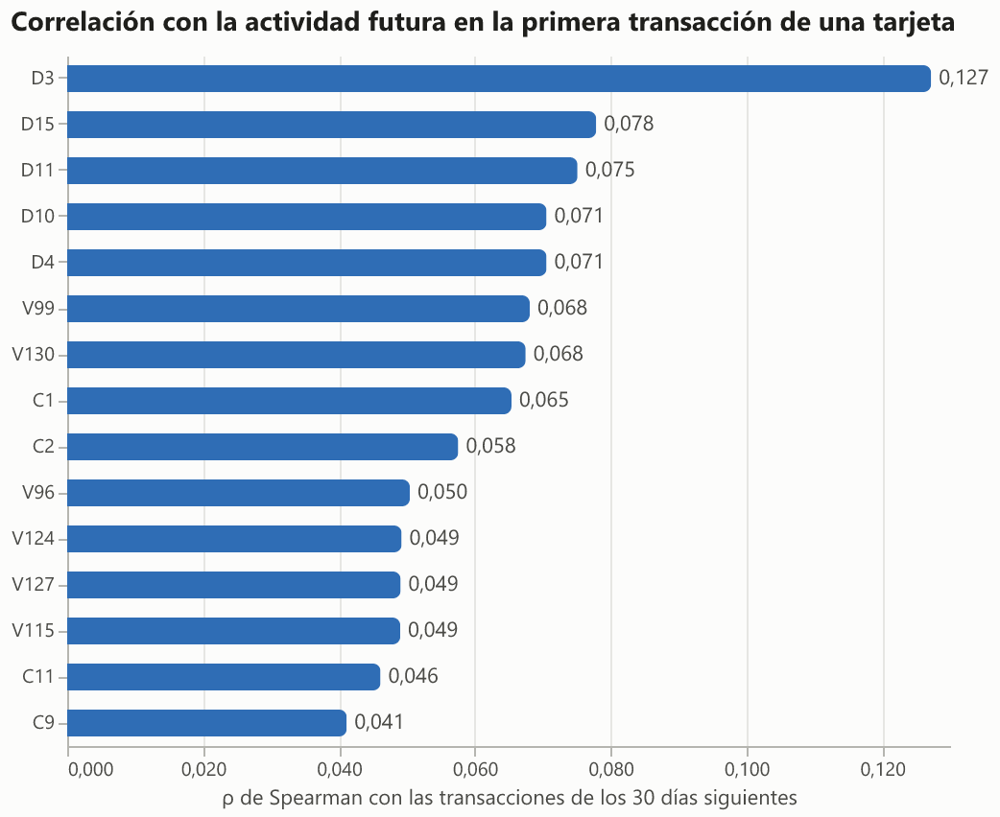

Dentro del cliente, las C casi siempre se mantienen (C1 igual en el 77 % de los pares
consecutivos, C3 en el 99,8 %) pero a veces bajan (C1 en el 10 %): no son contadores
acumulados puros, quizá conteos por ventana. Esto **no prueba** que estén limpias: son
opacas y siguen declaradas sospechosas, con ablación en el hito 3.

**3. Registro de grupos** (`sospechas.GRUPOS`, verificado por una prueba que cubre todas las
columnas del esquema): historia de etiquetas del cliente, C, D, V e identidad, sospechosos;
datos de la transacción (monto, producto, tarjeta, dirección, distancia, correo, M), no
sospechosos.

### Lo que deja el hito 1 para los siguientes

- Tabla `clientes` (`TransactionID`, `uid`) en `data/fraude.duckdb`.
- Hito 2: los fragmentos de `uid` (sobre todo H y R) se conectan en el grafo por correo,
  dispositivo y dirección. Las variables de vecindario y de historia de etiquetas usan solo
  el pasado, y las etiquetas con el retraso de contracargo.
- Hito 3: reporte con y sin sospechosas, y para clientes nuevos y ya vistos.
- Hito 4: deriva en las M y en la identidad entre desarrollo y prueba.

---

## Hito 2: grafo de identidad compartida y variables de vecindario

### Esquema realista de entrenamiento (decisión del usuario)

El modelo entra a producción el día 121. Con 30 días de retraso de contracargo, ese día solo
se conocen las etiquetas de las transacciones hasta el **día 90**. El esquema principal
respeta eso (`particion.ESQUEMAS`, verificado por una prueba):

| Esquema | Entrenamiento | Validación (regularización, umbral) | Reajuste final | Uso |
|---|---|---|---|---|
| **realista** | días 1 a 60 | días 61 a 90 | días 1 a 90 | principal |
| todas las etiquetas | días 1 a 90 | días 91 a 120 | días 1 a 120 | solo comparación |

En el esquema realista, los días 91 a 120 son historia sin etiqueta: alimentan las variables
de vecindario pero no el entrenamiento. Esto reemplaza la simplificación declarada en el
hito 1.

### El grafo

Cada transacción se une a seis entidades ([desarrollo.json](docs/resultados/hito2/desarrollo.json)):

| Entidad | Definición | Entidades | Clientes por entidad (mediana / p99 / máx.) |
|---|---|---|---|
| cliente | `uid` del hito 1 | 217.850 | 1 / 1 / 1 |
| tarjeta y dirección | `card1 + addr1` | 39.974 | 1 / 75 / 505 |
| tarjeta | perfil `card1` a `card6` | 14.893 | 2 / 258 / 3.306 |
| huella de dispositivo | `DeviceInfo` + SO + navegador + pantalla + `id_19` + `id_20` (20 % de las tx) | 55.160 | 1 / 10 / 776 |
| dirección | `addr1 + addr2` (región) | 437 | 2 / 9.135 / 15.804 |
| correo | dominio del comprador | 59 | 154 / 69.792 / 101.220 |

**IEEE-CIS no trae la dirección de correo, solo el dominio:** gmail.com reúne a 101 mil
clientes. El correo y la dirección son atributos del vecindario, no identificadores; la
huella es la única entidad realmente específica.

**Componentes y transitividad.** Unir clientes que comparten huella o perfil de tarjeta
forma un componente gigante aunque cada entidad deje de unir al llegar a 5 clientes: en
desarrollo llega a **13.047 clientes**, construido en orden de tiempo. Es la lección del
proyecto 1 sobre las uniones transitivas. Por eso el hito se apoya en variables acotadas (uno
y dos saltos); el componente queda como una variable más. En la validación realista, las
transacciones de componentes de más de 100 clientes tienen 9,6 % de fraude contra 3,3 % de
las de un cliente solo, y las de un componente con exactamente un cliente con fraude ya
conocido, 40,0 %.

### Variables de vecindario (solo pasado)

`vecindario.py`, 139 columnas. El pasado de una transacción son las de `TransactionID`
menor; las etiquetas entran solo si `ts <= t - R` días. Por entidad: transacciones previas,
en 24 horas y en 7 días, antigüedad, clientes distintos y si el cliente es nuevo para la
entidad; con cada retraso `R` (0, 15, 30, 60, 90): transacciones con etiqueta conocida,
fraudes conocidos y clientes con fraude conocido. Del cliente a dos saltos: huellas, correos
y perfiles de tarjeta distintos usados antes. Componentes en línea con contadores de fraude
que llegan con el retraso.

Pruebas que lo verifican (`tests/test_vecindario.py`): truncar en el día 100 no cambia nada de
lo anterior, y **cambiar las etiquetas de los últimos 30 días antes de `t` no cambia ninguna
variable con retraso 30 en `t`** (sí las de retraso 0).

> **Error encontrado antes de congelar.** La primera corrida de `desarrollar` dio AP = 1,0 en
> validación: `isFraud` entraba como variable porque la lista de columnas se tomaba de la
> tabla cargada con la etiqueta. Se corrigió antes del tag, con dos pruebas que lo impiden.

### Cuánto aportan: ocho variantes congeladas y medidas una vez

Modelo deliberadamente simple: regresión logística sobre `log1p` de las variables, con la
regularización elegida en validación (`modelo_lineal.py`). El modelo base es XGBoost, en el
hito 3; aquí solo se mide el aporte del grafo y de la historia de etiquetas. Parámetros
congelados en el tag **`hito2-congelado`** ([parametros.json](docs/resultados/hito2/parametros.json));
`evaluar` se niega a correr si el archivo no coincide con el del tag.

**Prueba, días 121 a 182** ([evaluacion.json](docs/resultados/hito2/evaluacion.json)):
175.998 transacciones y 6.063 fraudes (3,44 %). **Clientes nuevos** (sin transacciones en
desarrollo): 104.995 tx, 4,40 % de fraude. **Ya vistos:** 71.003 tx, 2,04 %. AP con intervalo
del 95 % por bootstrap de clientes; recall con 1 % de falsas alarmas.

| Variante | AP todos | AP nuevos | AP vistos | Recall al 1 % (todos) |
|---|---|---|---|---|
| Prevalencia (azar) | 0,034 | 0,044 | 0,020 | 1 % |
| Regla: fraudes conocidos del cliente (retraso 30) | 0,155 [0,124–0,185] | 0,052 | 0,510 | 19,2 % |
| Vecindario sin etiquetas | 0,107 [0,083–0,159] | 0,119 | 0,063 | 5,7 % |
| **Vecindario, retraso 30 (principal, realista)** | **0,360 [0,318–0,407]** | **0,182 [0,145–0,222]** | **0,784 [0,724–0,826]** | **26,2 %** |
| Vecindario, retraso 15 | 0,430 [0,392–0,463] | 0,249 | 0,841 | 33,6 % |
| Vecindario, retraso 60 | 0,199 [0,137–0,328] | 0,121 | 0,625 | 15,7 % |
| Vecindario, retraso 90 | 0,107 [0,083–0,159] | 0,118 | 0,063 | 5,8 % |
| Vecindario, sin retraso (filtración) | 0,681 [0,649–0,710] | 0,603 | 0,886 | 63,5 % |
| Vecindario, retraso 30, todas las etiquetas | 0,382 [0,347–0,421] | 0,210 | 0,783 | 29,5 % |

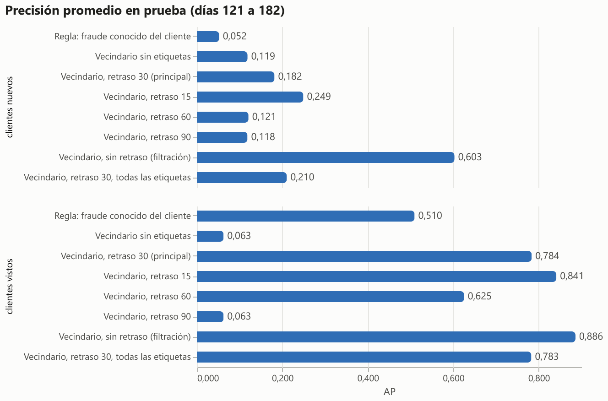
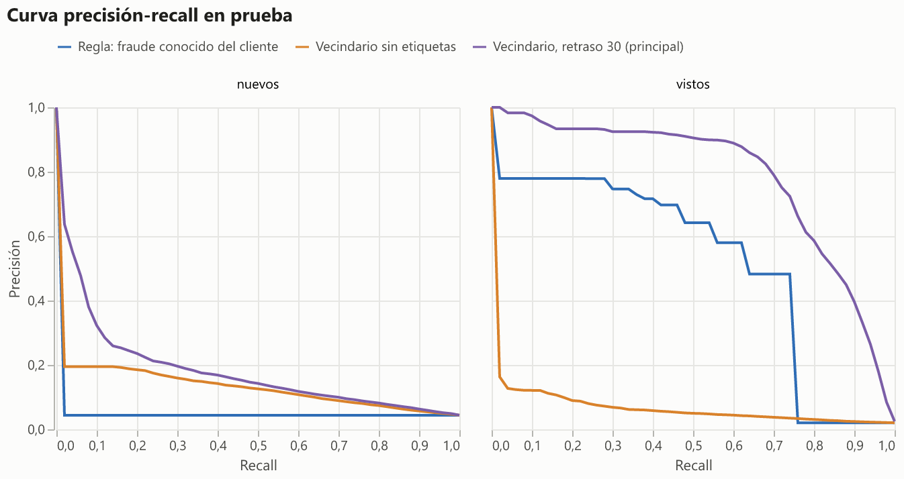

Lectura:

1. **Casi todo el aporte está en los clientes ya vistos.** La variante principal pasa de
   0,182 en clientes nuevos a 0,784 en ya vistos, aunque los vistos tienen menos fraude
   (2,0 %). Es la huella de la propagación de etiquetas del hito 1: si el cliente ya tuvo un
   fraude conocido, lo que sigue también se marcó como fraude. Los resultados de cualquier
   modelo sobre IEEE-CIS se tienen que leer por separado.
2. **En clientes nuevos, el grafo sí ayuda, pero poco.** La estructura sin etiquetas sube la
   AP de 0,044 (azar) a 0,119, y agregar las etiquetas con retraso del vecindario (tarjeta,
   huella, componente), a 0,182.
3. **Ignorar el retraso infla casi al doble:** 0,681 contra 0,360. Esa variante usa en el
   tiempo `t` etiquetas que en producción llegarían semanas después.
4. **Entrenar con todas las etiquetas de desarrollo infla poco:** 0,382 contra 0,360, con
   intervalos que se solapan; la diferencia está en clientes nuevos (0,210 contra 0,182).
5. **El retraso importa mucho.** Con 15 días, la AP sube a 0,430; con 60, baja a 0,199. Con
   60 días, las variables de etiquetas valen cero en todo el entrenamiento (días 1 a 60), así
   que la regularización se eligió sin ellas y solo el reajuste con los días 1 a 90 las ve.
   Con 90, no hay ninguna etiqueta conocida dentro de los días 1 a 90 y el modelo queda igual
   al que no usa etiquetas (0,107).
6. **Validación contra prueba.** La AP principal fue 0,326 en validación (días 61 a 90) y
   0,360 en prueba; la de nuevos, 0,187 y 0,182. No hay señales de sobreajuste a la
   validación.

### Lo que deja el hito 2 para el hito 3

- Tablas `entidades` y `vecindario` en la base, y el esquema realista como principal.
- **Referencias simples** para comparar: la regla de fraudes conocidos del cliente y esta
  logística de vecindario.
- XGBoost con `device="cuda"` y búsqueda de hiperparámetros en GPU, con validación en los
  días 61 a 90; evaluación en prueba cargando los pesos congelados y puntuando en CPU.
- Ablaciones: sin las variables sospechosas (C, D, V, identidad), sin historia de etiquetas
  del cliente, y siempre clientes nuevos y ya vistos por separado.
- Red sobre el grafo (PyTorch Geometric en GPU) solo si aporta sobre XGBoost en clientes
  nuevos, que es donde el grafo tiene algo que decir.
